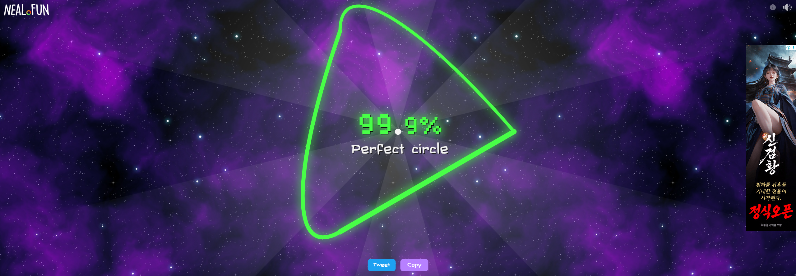
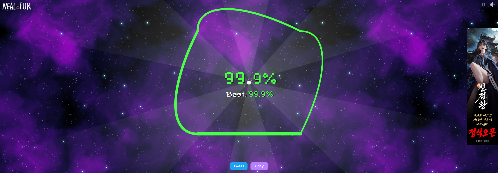

# 역설의 다각형: 원이 아닌데 99.9% 만점을 받는 비밀

[neal.fun/perfect-circle](https://neal.fun/perfect-circle/)에서 "가장 원 같지 않은 모양을 그렸을 때 최고 점수가 나오는 현상"을 다루는 가이드입니다.

화면에 날카로운 정삼각형이나 반듯한 사각형을 그렸는데도, 게임 엔진은 이를 **`99.9% (Perfect circle)`** 로 판정하며 축하 광선을 뿜어냅니다.

*(위 사진: 실제 브라우저에서 날카로운 정삼각형을 그리고 99.9% Perfect Circle 판정을 받은 화면)*

---

## 1. 어떻게 삼각형이 원으로 둔갑하는가?

비밀은 게임 엔진의 **점 평가 방식**에 있습니다.

사람의 눈은 화면에 그려진 선 전체의 모양을 보고 "삼각형이다", "원이다"를 판단합니다. 하지만 컴퓨터 게임 엔진은 화면에 실제로 그어진 선분을 실시간으로 감시하지 않습니다. 마우스 이벤트가 들어온 **그 순간의 점 좌표** 몇 개만 확인합니다.

1. **점의 위치만 확인**: 게임 엔진은 마우스가 찍힌 점과 중심점 사이의 거리가 처음 반지름과 같은지만 봅니다.
2. **점 사이의 선은 무검사**: 점과 점 사이에 브라우저가 직선을 긋든, 곡선을 긋든 게임 엔진은 관심이 없습니다.
3. **120도 간격의 마술**: 정삼각형의 세 꼭짓점은 중심점에서 정확히 같은 반지름 거리에 있습니다. 마우스를 120도 간격으로 3번만 빠르게 찍고 닫으면, 게임 엔진은 "처음 점도 350픽셀, 두 번째 점도 350픽셀, 세 번째 점도 350픽셀 떨어진 위치네? 전부 완벽한 반지름이야!"라고 판단합니다.
4. **결과**: 화면에는 3개의 날카로운 직선 변을 가진 삼각형이 덩그러니 남지만, 내부 계산기에서는 오차율이 0%로 나와 **99.9% 만점**이 부여됩니다.

사각형 역시 마찬가지입니다. 90도 간격으로 4개의 꼭짓점만 찍으면 화면에는 네모난 상자가 그려지지만 점수는 99.9%가 나옵니다.

*(위 사진: 90도 직각 모서리를 가진 사각형을 그리고 99.9%를 획득한 화면)*

---

## 2. 사용 방법

1. 브라우저로 [https://neal.fun/perfect-circle/](https://neal.fun/perfect-circle/) 에 접속합니다.
2. `F12` 키를 눌러 개발자 도구를 켜고 **Console (콘솔)** 탭으로 이동합니다.
3. 저장소의 [`paradox_shapes.js`](paradox_shapes.js) 파일 내용을 복사합니다.
4. 콘솔창에 붙여넣고 `Enter`를 누릅니다.

기본 설정은 **날카로운 정삼각형**입니다. 코드 12번째 줄의 `SELECTED_SHAPE` 변수를 수정하면 다른 다각형으로 바꿀 수 있습니다:

- `"triangle"`: 120도 간격의 날카로운 정삼각형 (기본값)
- `"square"`: 90도 간격의 정사각형
- `"pentagon"`: 72도 간격의 정오각형

---

## 3. 공학적 시사점

이 현상은 디지털 신호 처리와 수치 해석에서 자주 마주치는 **나이퀴스트-섀넌 샘플링 정리(Nyquist-Shannon Sampling Theorem)**의 극단적인 예시입니다.

연속적인 곡선을 이산적인 점으로 복원하려면 최소한 곡선 최고 주파수의 2배 이상으로 샘플을 채취해야 합니다. 하지만 게임 엔진은 단 3개의 점만으로 360도 전체를 대표값으로 적분해버렸기 때문에, 점과 점 사이의 거대한 직선 현(Chord) 왜곡을 감지하지 못하는 시스템적 맹점이 발생한 것입니다.
